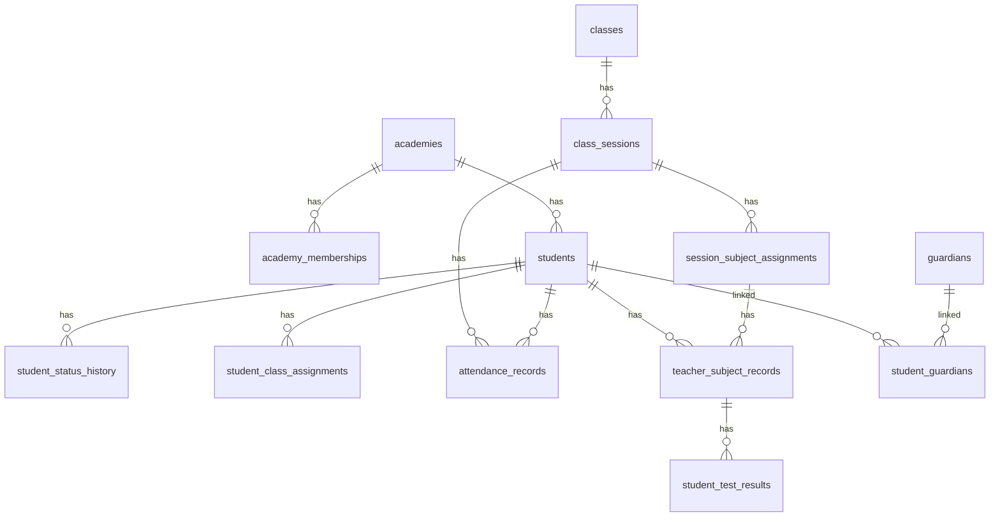

# 데이터베이스 ERD와 테이블 정의서

## 1. 목적

이 문서는 기능별 데이터를 어느 표에 저장할지 고정하는 기준입니다. 코드를 만들기 전에 이 문서에 없는 표·관계·상태값을 임의로 추가하지 않습니다.

모든 업무 표에는 `academy_id`를 둡니다. 시스템 관리용 학원 표만 예외입니다. 기본키는 UUID, 생성·수정 시각은 서버시각으로 저장합니다.

## 2. 핵심 관계

## 3. 공통 규칙

- 모든 ID는 UUID를 사용한다.
- `academy_id`는 사용자가 보내는 값만 믿지 않고 로그인 계정의 소속 학원과 서버에서 대조한다.
- 삭제 대신 `is_active=false` 또는 상태 변경을 우선 사용한다.
- 과거 기록에 표시할 반 이름·과목명·교사명·설정값은 기록 저장 시 스냅샷 필드로 보관한다.
- 공개자료, 비공개자료, 감사로그, 내보내기 이력은 서로 다른 표로 분리한다.
- `created_at`, `updated_at`은 UTC 서버시각으로 저장하고 화면에서 한국 표준시로 표시한다.

## 4. 표 목록

| 구분 | 표 이름 | 역할 | 핵심 고유조건 |
|---|---|---|---|
| 학원·계정 | academies | 학원 기본정보 | 학원 코드 |
| 학원·계정 | profiles | 로그인 사용자 기본정보 | auth_user_id |
| 학원·계정 | academy_memberships | 사용자별 학원 역할·활성 상태 | academy_id + profile_id |
| 학생 | students | 학생 기본정보·현재 상태 | academy_id + student_no |
| 학생 | guardians | 보호자 기본정보 | academy_id + 연락처(정책 검토) |
| 학생 | student_guardians | 학생·보호자 연결 | academy_id + student_id + guardian_id |
| 학생 | student_status_history | 재원·휴원·퇴원 변경 이력 | 상태 변경 ID |
| 학사 | school_years | 학년도 | academy_id + name |
| 학사 | terms | 학기 | academy_id + school_year_id + name |
| 학사 | classes | 반 | academy_id + name |
| 학사 | subjects | 과목 | academy_id + name |
| 학사 | student_class_assignments | 학생 반배정 이력 | student_id + class_id + term_id + start_date |
| 수업 | recurring_timetables | 반복 시간표 | academy_id + class_id + 요일·시간·기간 |
| 수업 | class_sessions | 실제 수업 회차 | academy_id + class_id + session_date + start_time |
| 수업 | session_subject_assignments | 회차별 과목·예정교사 스냅샷 | session_id + subject_id + teacher_id |
| 수업 | session_student_rosters | 회차별 예정 학생 스냅샷 | session_id + student_id |
| 기록 | attendance_records | 출결·결석 전달사항 | academy_id + student_id + session_id |
| 기록 | common_homework | 반 공통 숙제 | academy_id + class_id + session_id |
| 기록 | teacher_subject_records | 교사별 과목 학습기록 | academy_id + student_id + session_id + subject_id + teacher_id |
| 기록 | test_definitions | 반 전체 테스트 정의 | academy_id + session_id + subject_id + teacher_id + sequence_no |
| 기록 | student_test_results | 학생별 테스트 점수·미응시 | academy_id + student_id + test_definition_id |
| 비공개 | private_records | 상담·인수인계·내부 메모 | private_record_id |
| 비공개 | parent_consultations | 학부모 상담 세부기록 | consultation_id |
| 공개 | publication_bundles | 학생·회차별 공개 묶음 | academy_id + student_id + session_id |
| 공개 | publication_snapshots | 공개 당시 항목 설정 스냅샷 | publication_bundle_id + item_key |
| 변경 | change_requests | 교사의 수정요청 | 대상 기록 + 항목 + 대기 상태 |
| 변경 | audit_logs | 수정·승인 감사로그 | audit_log_id |
| 위험군 | risk_rule_settings | 관리 필요 학생 설정 | academy_id + item_key |
| 위험군 | student_risk_results | 현재·과거 판정 결과 | academy_id + student_id + evaluated_at |
| 알림 | notifications | 알림 이력 | notification_key + channel |
| 문의 | inquiries | 학부모 문의 | academy_id + student_id + guardian_id |
| 문의 | inquiry_messages | 문의·답변 메시지 | inquiry_id + created_at |
| 인증 | guardian_invites | 보호자 초대링크·인증키 | invite_token_hash |
| 인증 | guardian_devices | 보호자 등록 기기·조회 세션 | guardian_id + device_id |
| 인증 | push_subscriptions | 기기별 Web Push 구독 | guardian_device_id |
| 운영 | export_logs | 엑셀·비공개자료 내보내기 이력 | export_no |
| 운영 | academy_setting_history | 공개항목·SMS 설정 변경 이력 | academy_id + changed_at |

## 5. 핵심 표 필드

### 5.1 academies

| 필드 | 설명 |
|---|---|
| id | 학원 ID |
| name | 학원명 |
| status | active / inactive |
| created_at | 생성 시각 |

### 5.2 profiles와 academy_memberships

`profiles`는 로그인한 사람 한 명의 공통 정보, `academy_memberships`는 그 사람이 특정 학원에서 가진 역할을 저장합니다.

| 표 | 핵심 필드 |
|---|---|
| profiles | id, auth_user_id, display_name, phone, email |
| academy_memberships | id, academy_id, profile_id, role(system_admin / academy_admin / teacher), is_active, activated_at, deactivated_at |

보호자는 별도 회원가입 대신 초대인증 후 `guardians`, `guardian_devices` 기준으로 조회합니다. 보호자에게 일반 교사 계정을 만들지 않습니다.

### 5.3 students와 상태 이력

| 표 | 핵심 필드 |
|---|---|
| students | id, academy_id, student_no, name, school_name, grade, registered_at, level, phone, current_status |
| student_status_history | id, academy_id, student_id, previous_status, next_status, effective_date, withdrawal_type, reason, changed_by_profile_id, created_at |

`withdrawal_type`은 `normal`, `mid_course`, `transfer`, `other`를 사용합니다. 최초 등록일은 `students.registered_at`으로 유지하고, 휴원 후 복귀는 상태 이력으로만 남깁니다.

### 5.4 학사·반배정·수업 회차

| 표 | 핵심 필드 |
|---|---|
| school_years | academy_id, name, start_date, end_date |
| terms | academy_id, school_year_id, name, start_date, end_date, is_current |
| classes | academy_id, name, category, is_active |
| subjects | academy_id, name, is_active |
| student_class_assignments | academy_id, student_id, class_id, term_id, start_date, end_date, status |
| recurring_timetables | academy_id, class_id, weekday, start_time, end_time, effective_start, effective_end, is_active |
| class_sessions | academy_id, class_id, term_id, session_date, start_time, end_time, status, lead_teacher_id |
| session_subject_assignments | academy_id, session_id, subject_id, teacher_id, subject_name_snapshot, teacher_name_snapshot, expected_status |
| session_student_rosters | academy_id, session_id, student_id, class_assignment_id, class_name_snapshot, is_expected |

`class_sessions`는 실제 수업 회차입니다. 시간표를 바꾸어도 이미 생성·최종저장된 회차는 바꾸지 않습니다. 미래 회차만 운영자가 예외 처리합니다.

### 5.5 출결·숙제·과목기록·테스트

| 표 | 핵심 필드 | 상태·제약 |
|---|---|---|
| attendance_records | academy_id, student_id, session_id, attendance_status, absence_note, final_saved_at, version | 학생·회차당 1건 |
| common_homework | academy_id, class_id, session_id, content, no_homework, final_saved_at, version | 반·회차당 1건 |
| teacher_subject_records | academy_id, student_id, session_id, subject_id, teacher_id, homework_score, understanding_score, participation_score, remedial_type, remedial_note, personal_homework, public_note, status, first_final_saved_at, version | 학생·회차·과목·교사당 1건 |
| test_definitions | academy_id, session_id, subject_id, teacher_id, sequence_no, name, max_score | sequence_no는 1~3 |
| student_test_results | academy_id, student_id, test_definition_id, score, non_attempt_reason | 점수와 미응시 사유는 동시에 저장하지 않음 |

`attendance_status`는 `present`, `absent`, `unexcused_absent`입니다. 결석·무단결석이면 서버가 테스트·5점 평가·나머지/보충·미이행과제·공개특이사항 저장을 거절합니다.

### 5.6 비공개기록과 상담

| 표 | 핵심 필드 |
|---|---|
| private_records | academy_id, student_id, record_type(consultation / risk_note / handover), content, author_profile_id, created_at |
| parent_consultations | academy_id, student_id, guardian_id, consultation_at, teacher_id, method(phone / in_person / online / other), status(completed / unreachable / scheduled / not_required), content |

상담 완료는 대상 보호자·상담일시·상담 방식·내용이 모두 있을 때만 저장할 수 있습니다. 형제자매 상담은 학생별 기록을 각각 남깁니다.

### 5.7 공개·수정·감사

| 표 | 핵심 필드 |
|---|---|
| publication_bundles | academy_id, student_id, session_id, status(drafting / ready / published), approved_by_profile_id, approved_at, corrected_at |
| publication_snapshots | publication_bundle_id, item_key, is_visible, label_snapshot |
| change_requests | academy_id, requested_by_profile_id, target_table, target_id, field_key, requested_value_json, reason, status(pending / approved / rejected), reviewed_by_profile_id, reviewed_at |
| audit_logs | academy_id, target_table, target_id, field_key, old_value_json, new_value_json, reason, actor_profile_id, created_at |

`audit_logs`는 append-only입니다. 기존 행의 수정·삭제를 허용하지 않습니다.

### 5.8 위험군·알림·문의·내보내기

| 표 | 핵심 필드 |
|---|---|
| risk_rule_settings | academy_id, item_key, is_enabled, threshold_score, lookback_days, minimum_count, minimum_valid_sessions |
| student_risk_results | academy_id, student_id, evaluated_at, is_at_risk, reasons_json, rules_snapshot_json |
| notifications | academy_id, notification_key, recipient_type, recipient_id, notification_type, channel(web_push / sms), status, failure_reason, sent_at |
| inquiries | academy_id, student_id, guardian_id, status(received / answered / closed), created_at |
| inquiry_messages | inquiry_id, author_type, author_id, body, created_at, hidden_at, hidden_reason |
| export_logs | academy_id, export_no, exported_by_profile_id, export_type, filters_json, target_summary_json, created_at, result_status |

## 6. 데이터베이스 고유조건

| 기록 | 고유조건 |
|---|---|
| 출결 | academy_id + student_id + session_id |
| 반 공통 숙제 | academy_id + class_id + session_id |
| 교사별 과목기록 | academy_id + student_id + session_id + subject_id + teacher_id |
| 테스트 정의 | academy_id + session_id + subject_id + teacher_id + sequence_no |
| 학생별 테스트 결과 | academy_id + student_id + test_definition_id |
| 학부모 공개 묶음 | academy_id + student_id + session_id |
| 알림 발송 | notification_key + channel |

## 7. 필수 인덱스

- 모든 업무 표의 `(academy_id, created_at)`
- `students(academy_id, current_status, registered_at)`
- `student_status_history(academy_id, student_id, effective_date)`
- `student_class_assignments(academy_id, class_id, term_id, start_date, end_date)`
- `class_sessions(academy_id, class_id, session_date)`
- `teacher_subject_records(academy_id, student_id, session_id)`
- `attendance_records(academy_id, student_id, session_id)`
- `parent_consultations(academy_id, student_id, consultation_at, status)`
- `student_risk_results(academy_id, is_at_risk, evaluated_at)`

## 8. RLS 기본 원칙

- 노출되는 모든 표에 RLS를 활성화한다.
- 학원 운영자는 자기 `academy_id` 데이터만 접근한다.
- 교사는 현재 수업·과목 배정과 연결된 행만 접근한다.
- 보호자는 `student_guardians`로 연결된 학생의 `published` 공개 묶음만 읽는다.
- 비공개 기록은 현재 담당교사와 학원 운영자만 읽는다.
- 시스템 관리자는 서비스 운영 표만 읽고 학습·비공개기록의 본문은 읽지 않는다.
- RLS만으로 부족한 복합 규칙은 서버 작업 함수에서 다시 검증한다.
