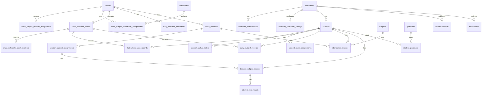

# 데이터베이스 ERD와 테이블 정의서

## 1. 목적

이 문서는 기능별 데이터를 어느 표에 저장할지 고정하는 기준입니다. 현재 신규 운영 흐름은 수업 회차를 생성하지 않고 `반 운영 블록 + 수업일자`를 기록 단위로 사용합니다. 기존 회차·공개 표는 과거 이력 호환용으로 보존하며 신규 화면에서 생성·승인하지 않습니다.

모든 업무 표에는 `academy_id`를 둡니다. 시스템 관리용 학원 표만 예외입니다. 기본키는 UUID, 생성·수정 시각은 서버시각으로 저장합니다.

## 2. 핵심 관계

## 3. 공통 규칙

- 모든 ID는 UUID를 사용한다.
- `academy_id`는 사용자가 보내는 값만 믿지 않고 로그인 계정의 소속 학원과 서버에서 대조한다.
- 삭제 대신 `is_active=false` 또는 상태 변경을 우선 사용한다.
- 과거 기록에 표시할 반 이름·과목명·교사명·설정값은 기록 저장 시 스냅샷 필드로 보관한다.
- 공개자료, 비공개자료, 감사로그, 내보내기 이력은 서로 다른 표로 분리한다.
- `created_at`, `updated_at`은 UTC 서버시각으로 저장하고 화면에서 한국 표준시로 표시한다.

## 4. 표 목록

| 구분 | 표 이름 | 역할 | 핵심 고유조건 |
|---|---|---|---|
| 학원·계정 | academies | 학원 기본정보 | 학원 코드 |
| 학원·계정 | profiles | 로그인 사용자 기본정보 | auth_user_id |
| 학원·계정 | academy_memberships | 사용자별 학원 역할·활성 상태 | academy_id + profile_id |
| 학원·계정 | academy_operation_settings | 학원 공통 수업시간·문법/독해 자원 설정 | academy_id |
| 학생 | students | 학생 기본정보·현재 상태·기존 강의실 이력 | academy_id + student_no |
| 학생 | guardians | 보호자 기본정보 | academy_id + 연락처(정책 검토) |
| 학생 | student_guardians | 학생·보호자 연결 | academy_id + student_id + guardian_id |
| 학생 | student_status_history | 재원·휴원·퇴원 변경 이력 | 상태 변경 ID |
| 학사 | school_years | 학년도 운영기간 | academy_id + name |
| 학사 | terms | 자동 생성 학기·보관 상태 | academy_id + school_year_id + name |
| 학사 | classes | 반·분류·요일·시간 | academy_id + name |
| 학사 | classrooms | 강의실 | academy_id + name |
| 학사 | subjects | 과목 | academy_id + name |
| 학사 | student_class_assignments | 학생 반배정 이력 | student_id + class_id + term_id + start_date |
| 학사 | class_subject_teacher_assignments | 반별 문법·독해 담당교사 이력 | academy_id + class_id + subject_id + effective_start |
| 학사 | class_subject_classroom_assignments | 반별 과목 강의실 이력 | academy_id + class_id + subject_id + effective_start |
| 수업 | recurring_timetables | 반복 시간표 | academy_id + class_id + 요일·시간·기간 |
| 수업 | class_schedule_blocks | 반·과목·교사·강의실·요일·시간 운영 설정 | academy_id + class_id + subject_id + teacher_id + weekday + effective_start |
| 수업 | class_schedule_block_students | 운영 블록별 학생 배정 기간 | block_id + student_id + start_date |
| 수업(레거시) | class_sessions | 과거 실제 수업 회차 이력 | academy_id + class_id + session_date + start_time |
| 수업(레거시) | session_subject_assignments | 과거 회차별 과목·교사 스냅샷 | session_id + subject_id + teacher_id |
| 수업(레거시) | session_student_rosters | 과거 회차별 예정 학생 스냅샷 | session_id + student_id |
| 기록 | attendance_records | 과목별 출결·결석 전달사항 | academy_id + student_id + session_id + subject_id |
| 기록 | common_homework | 반 공통 숙제 | academy_id + class_id + session_id |
| 기록 | teacher_subject_records | 교사별 과목 학습기록 | academy_id + student_id + session_id + subject_id + teacher_id |
| 기록 | daily_attendance_records | 날짜·운영블록별 출결·저장상태 | academy_id + block_id + student_id + record_date |
| 기록 | daily_common_homework | 날짜·반·운영구분별 공통 숙제·저장상태 | academy_id + class_id + record_date + operation_group(A/B/common) |
| 기록 | daily_subject_records | 날짜·운영블록별 과목 학습기록·저장상태 | academy_id + block_id + student_id + record_date |
| 공개 | daily_record_publications | 학생·수업일 단위 보호자 공개 게이트 | academy_id + student_id + record_date |
| 기록 | test_definitions | 반 전체 테스트 정의 | academy_id + session_id + subject_id + teacher_id + sequence_no |
| 기록 | student_test_results | 학생별 테스트 점수·미응시 | academy_id + student_id + test_definition_id |
| 비공개 | private_records | 상담·인수인계·내부 메모 | private_record_id |
| 비공개 | parent_consultations | 학부모 상담 세부기록 | consultation_id |
| 공개 | publication_bundles | 학생·회차별 공개 묶음 | academy_id + student_id + session_id |
| 공개 | publication_snapshots | 공개 당시 항목 설정 스냅샷 | publication_bundle_id + item_key |
| 공지 | announcements | 운영자 공지사항·게시상태 | academy_id + created_at |
| 변경(레거시) | change_requests | 기존 회차 흐름의 변경요청 이력 보존 | 대상 기록 + 항목 + 처리 상태 |
| 변경 | audit_logs | 수정·승인 감사로그 | audit_log_id |
| 위험군 | risk_rule_settings | 관리 필요 학생 설정 | academy_id + item_key |
| 위험군 | student_risk_results | 현재·과거 판정 결과 | academy_id + student_id + evaluated_at |
| 알림 | notifications | 역할별 인앱 알림 이력 | academy_id + recipient + created_at |
| 문의 | inquiries | 학부모 문의 | academy_id + student_id + guardian_id |
| 문의 | inquiry_messages | 문의·답변 메시지 | inquiry_id + created_at |
| 인증 | guardian_invites | 보호자 접속 링크·인증번호(60일·최대 5회) | invite_token_hash + expires_at + use_count + revoked_at |
| 인증 | guardian_devices | 보호자 등록 기기·조회 세션(활성 1대) | guardian_id + device_id + is_active |
| 인증 | push_subscriptions | 기기별 Web Push 구독 | guardian_device_id |
| 운영 | export_logs | 엑셀·비공개자료 내보내기 이력 | export_no |
| 운영 | academy_setting_history | 공개항목·SMS 설정 변경 이력 | academy_id + changed_at |

## 5. 핵심 표 필드

### 5.1 academies

| 필드 | 설명 |
|---|---|
| id | 학원 ID |
| name | 학원명 |
| status | active / inactive |
| created_at | 생성 시각 |

### 5.2 profiles와 academy_memberships

`profiles`는 로그인한 사람 한 명의 공통 정보, `academy_memberships`는 그 사람이 특정 학원에서 가진 역할을 저장합니다.

| 표 | 핵심 필드 |
|---|---|
| profiles | id, auth_user_id, display_name, phone, email |
| academy_memberships | id, academy_id, profile_id, role(system_admin / academy_admin / teacher), is_active, activated_at, deactivated_at |

보호자는 별도 회원가입이나 비밀번호 없이 60일 유효·최대 5회 사용 가능한 접속 링크와 8자리 인증번호를 함께 확인한 뒤 `guardians`, `guardian_devices` 기준으로 조회합니다. 보호자에게 일반 교사 계정을 만들지 않습니다. 보호자당 활성 기기는 1대이며, 새 기기 인증 시 기존 기기를 비활성화합니다. 학생이 퇴원 처리되면 연결의 `access_revoked_at`을 기록하고, 조회 가능한 재원 자녀가 없는 보호자 계정은 `guardian_access_revoked_at`을 기록합니다. 링크를 재발급하면 기존의 사용 가능한 링크는 취소합니다.

### 5.3 students와 상태 이력

| 표 | 핵심 필드 |
|---|---|
| students | id, academy_id, student_no, name, school_name, grade, registered_at, level, classroom_id(기존 이력·nullable), guardian1_name, phone, phone_relationship, guardian2_name, phone2, phone2_relationship, current_status |
| student_status_history | id, academy_id, student_id, previous_status, next_status, effective_date, withdrawal_type, reason, changed_by_profile_id, created_at |

`withdrawal_type`은 `normal`, `mid_course`, `transfer`, `other`를 사용합니다. 최초 등록일은 `students.registered_at`으로 유지하고, 신규 등록 시 서버가 한국시간 기준 오늘 날짜를 기록합니다. 입력 화면에서는 등록일을 직접 수정하지 않습니다.

### 5.4 학사·반배정·반 운영 블록

| 표 | 핵심 필드 |
|---|---|
| school_years | academy_id, name, start_date, end_date |
| terms | academy_id, school_year_id, name, start_date, end_date, is_current, is_archived |
| classes | academy_id, name, category, meeting_days, start_time, end_time, operation_schedule_id, is_active |
| classrooms | academy_id, name, is_active |
| subjects | academy_id, name, is_active |
| academy_operation_settings | academy_id, grammar_subject_id, reading_subject_id, student_class_grid_columns, updated_at |
| student_class_assignments | academy_id, student_id, class_id, term_id, start_date, end_date, status |
| class_subject_teacher_assignments | academy_id, class_id, subject_id, teacher_id, effective_start, effective_end, is_active |
| class_subject_classroom_assignments | academy_id, class_id, subject_id, classroom_id, effective_start, effective_end, is_active |
| recurring_timetables | academy_id, class_id, weekday, start_time, end_time, effective_start, effective_end, is_active |
| class_schedule_blocks | academy_id, class_id, subject_id, teacher_id, classroom_id, classroom_name_snapshot, weekday, start_time, end_time, effective_start, effective_end, is_active |
| class_schedule_block_students | academy_id, block_id, student_id, operation_group(A/B), start_date, end_date, is_active |
| class_sessions(레거시) | academy_id, class_id, term_id, session_date, start_time, end_time, status, lead_teacher_id |
| session_subject_assignments(레거시) | academy_id, session_id, subject_id, teacher_id, subject_name_snapshot, teacher_name_snapshot, expected_status |
| session_student_rosters(레거시) | academy_id, session_id, student_id, class_assignment_id, class_name_snapshot, is_expected |

신규 운영자는 `/admin/academic?section=operation_settings`에서 요일별 공통 시작·종료시간을 설정하고, `/admin/academic?section=classes`에서 반별 문법·독해 담당교사와 과목별 강의실을 설정합니다. `/admin/students`에서는 학생 정보와 하나의 활성 반 배정만 관리하며 강의실은 선택하지 않습니다. `students.classroom_id`는 기존 데이터와 과거 호환을 위해 nullable로 보존하지만 신규 운영 블록은 반별 과목 강의실을 기준으로 생성합니다. 서버가 현재 날짜에 해당하는 학기를 자동 선택하며, 반별 담당교사와 강의실을 문법·독해 운영 블록에 각각 연결합니다. 다음 학기가 시작되면 서버가 이전 배정을 종료일로 보존하고 현재 학기 배정과 운영 블록을 자동 생성합니다. `/admin/class-operations`는 보정이 필요한 경우에만 사용하는 관리 화면입니다. 학생이 중간에 이동하면 운영 블록 학생 배정의 `start_date`/`end_date`로 기간을 나눕니다. 신규 기록은 `record_date`가 운영 블록의 요일·기간과 일치할 때만 저장합니다. 기존 `class_sessions`와 관련 표는 과거 이력 조회용으로만 보존합니다.

### 5.5 출결·숙제·과목기록·테스트

| 표 | 핵심 필드 | 상태·제약 |
|---|---|---|
| attendance_records | academy_id, student_id, session_id, subject_id, attendance_status, absence_note, final_saved_at, version | 학생·회차·과목당 1건. subject_id가 NULL인 기존 데이터는 호환용 |
| common_homework | academy_id, class_id, session_id, content, no_homework, final_saved_at, version | 반·회차당 1건 |
| teacher_subject_records | academy_id, student_id, session_id, subject_id, teacher_id, homework_score, understanding_score, participation_score, remedial_type, remedial_note, personal_homework, public_note, status, first_final_saved_at, version | 학생·회차·과목·교사당 1건 |
| test_definitions | academy_id, session_id, subject_id, teacher_id, sequence_no, name, max_score | sequence_no는 1~3 |
| student_test_results | academy_id, student_id, test_definition_id, score, non_attempt_reason | 점수와 미응시 사유는 동시에 저장하지 않음 |

`attendance_status`는 `present`, `absent`, `unexcused_absent`입니다. 결석·무단결석이면 서버가 테스트·5점 평가·나머지/보충·미이행과제·공개특이사항 저장을 거절합니다.

신규 날짜 기반 기록은 다음 표를 사용합니다.

| 표 | 핵심 필드 | 상태·제약 |
|---|---|---|
| daily_attendance_records | academy_id, block_id, student_id, record_date, attendance_status, absence_note, save_state, version | 운영 블록·학생·날짜당 1건. save_state=draft/final |
| daily_common_homework | academy_id, class_id, record_date, operation_group, content, no_homework, save_state, version | 반·날짜·운영구분당 1건. operation_group=A/B/common, save_state=draft/final |
| daily_subject_records | academy_id, block_id, student_id, record_date, subject_id, teacher_id, homework_score, understanding_score, participation_score, is_supplementary, public_note, test_definitions, test_results, save_state, version | 운영 블록·학생·날짜당 1건. save_state=draft/final |
| daily_record_publications | academy_id, student_id, record_date, status, updated_by_profile_id, updated_at | 학생·수업일당 1건. status=draft/published |

교사는 임시저장 또는 과목 최종저장을 선택합니다. 임시저장은 기록을 보존하지만 해당 학생·수업일의 `daily_record_publications.status`를 `draft`로 되돌려 이전 공개본도 보호자에게 숨깁니다. 최종저장 후 서버가 해당 날짜에 유효한 모든 과목 운영 블록에 대해 학생의 과목기록과 출결이 모두 `final`인지 확인한 경우에만 `published`로 전환합니다. 운영자가 공개 상태를 직접 입력하지 않으며 보호자 RLS와 조회 API는 공개 게이트가 열린 데이터만 반환합니다. 새 상태 흐름은 날짜별 자료에만 적용하고 과거 `publication_bundle` 승인 흐름은 유지합니다. `version`은 동시 저장 추적용으로 유지합니다.

### 5.6 비공개기록과 상담

| 표 | 핵심 필드 |
|---|---|
| private_records | academy_id, student_id, record_type(consultation / risk_note / handover), content, author_profile_id, created_at |
| parent_consultations | academy_id, student_id, guardian_id, consultation_at, teacher_id, method(phone / in_person / online / other), status(completed / unreachable / scheduled / not_required), content |

상담 완료는 대상 보호자·상담일시·상담 방식·내용이 모두 있을 때만 저장할 수 있습니다. 형제자매 상담은 학생별 기록을 각각 남깁니다.

### 5.7 공개·수정·감사

| 표 | 핵심 필드 |
|---|---|
| publication_bundles | academy_id, student_id, session_id, status(drafting / ready / published), approved_by_profile_id, approved_at, corrected_at |
| publication_snapshots | publication_bundle_id, item_key, is_visible, label_snapshot |
| academy_setting_history | academy_id, setting_key, value_json, changed_by_profile_id, changed_at |
| change_requests(레거시) | academy_id, requested_by_profile_id, target_table, target_id, field_key, requested_value_json, reason, status(pending / approved / rejected), reviewed_by_profile_id, reviewed_at |
| audit_logs | academy_id, target_table, target_id, field_key, old_value_json, new_value_json, reason, actor_profile_id, created_at |

`audit_logs`는 append-only입니다. 기존 행의 수정·삭제를 허용하지 않습니다.
날짜 기반 기록은 공개 후에도 담당 교사가 직접 수정하며, 현재 운영 흐름에서는 `change_requests`를 사용하지 않습니다. 기존 회차 데이터의 과거 변경요청 이력과 표는 삭제하지 않고 호환용으로 보존합니다.
`academy_setting_history`에는 보호자 공개 설정 변경을 누적 저장하며, 현재 값은 항목별 최신 행입니다. 현재는 `guardian_publication.homework_score`, `guardian_publication.understanding_score`, `guardian_publication.participation_score`를 사용하고 값은 `value_json.visible`에 저장합니다.

### 5.8 공지·위험군·알림·문의·내보내기

| 표 | 핵심 필드 |
|---|---|
| announcements | academy_id, title, body, audience(all / guardian / teacher), status(draft / published / archived), is_pinned, publish_at, expires_at, created_by_profile_id, updated_by_profile_id, created_at, updated_at |
| risk_rule_settings | academy_id, item_key, is_enabled, threshold_score, lookback_days, minimum_count, minimum_valid_sessions |
| student_risk_results | academy_id, student_id, evaluated_at, is_at_risk, reasons_json, rules_snapshot_json |
| notifications | academy_id, recipient_type(academy_admin / teacher / guardian), recipient_id, notification_type(announcement / inquiry), title, body, target_path, related_id, read_at, created_at |
| inquiries | academy_id, student_id, guardian_id, status(received / answered / closed), created_at |
| inquiry_messages | inquiry_id, author_type, author_id, body, created_at, hidden_at, hidden_reason |
| export_logs | academy_id, export_no, exported_by_profile_id, export_type(admin_report_csv / private_record_csv), filters_json, target_summary_json, created_at |

공지사항은 운영자가 임시저장하거나 게시할 수 있습니다. 게시된 공지만 대상 역할의 화면에 표시하며, `audience`와 게시·만료 시각을 서버가 함께 검사합니다. 현재 알림은 인앱 알림 이력으로 저장하고, Web Push·SMS 발송은 별도 채널 구현 범위입니다. 알림 행은 서버 API만 생성·읽음 처리하며 브라우저에는 수신자 변경 권한을 주지 않습니다.

## 6. 데이터베이스 고유조건

| 기록 | 고유조건 |
|---|---|
| 출결 | academy_id + student_id + session_id + subject_id |
| 반 공통 숙제 | academy_id + class_id + session_id |
| 교사별 과목기록 | academy_id + student_id + session_id + subject_id + teacher_id |
| 테스트 정의 | academy_id + session_id + subject_id + teacher_id + sequence_no |
| 학생별 테스트 결과 | academy_id + student_id + test_definition_id |
| 학부모 공개 묶음 | academy_id + student_id + session_id |
| 운영 블록 | academy_id + class_id + subject_id + teacher_id + weekday + start_time + effective_start |
| 운영 블록 학생 | block_id + student_id + start_date (operation_group은 A/B) |
| 날짜별 출결 | academy_id + block_id + student_id + record_date |
| 날짜별 공통 숙제 | academy_id + class_id + record_date + operation_group |
| 날짜별 과목기록 | academy_id + block_id + student_id + record_date |
| 공지사항 | UUID `id` |

## 7. 필수 인덱스

- 모든 업무 표의 `(academy_id, created_at)`
- `students(academy_id, current_status, registered_at)`
- `student_status_history(academy_id, student_id, effective_date)`
- `student_class_assignments(academy_id, class_id, term_id, start_date, end_date)`
- `academy_operation_settings(academy_id)`
- `class_sessions(academy_id, class_id, session_date)`
- `class_schedule_blocks(academy_id, teacher_id, is_active, effective_start, effective_end)`
- `class_schedule_block_students(academy_id, student_id, is_active, start_date, end_date)`
- `daily_attendance_records(academy_id, student_id, record_date, block_id)`
- `daily_subject_records(academy_id, student_id, record_date, block_id)`
- `teacher_subject_records(academy_id, student_id, session_id)`
- `attendance_records(academy_id, student_id, session_id, subject_id)`
- `parent_consultations(academy_id, student_id, consultation_at, status)`
- `student_risk_results(academy_id, is_at_risk, evaluated_at)`

## 8. RLS 기본 원칙

- 노출되는 모든 표에 RLS를 활성화한다.
- 학원 운영자는 자기 `academy_id` 데이터만 접근한다.
- 교사는 현재 수업·과목 배정과 연결된 행만 접근한다.
- 보호자는 `student_guardians`로 연결된 학생의 날짜 기반 저장 기록과 과거 `published` 공개 묶음만 읽는다.
- 교사는 현재 담당 운영 블록과 해당 날짜에 배정된 학생·과목 기록만 읽고 저장한다.
- 비공개 기록은 현재 담당교사와 학원 운영자만 읽는다.
- 시스템 관리자는 서비스 운영 표만 읽고 학습·비공개기록의 본문은 읽지 않는다.
- RLS만으로 부족한 복합 규칙은 서버 작업 함수에서 다시 검증한다.
