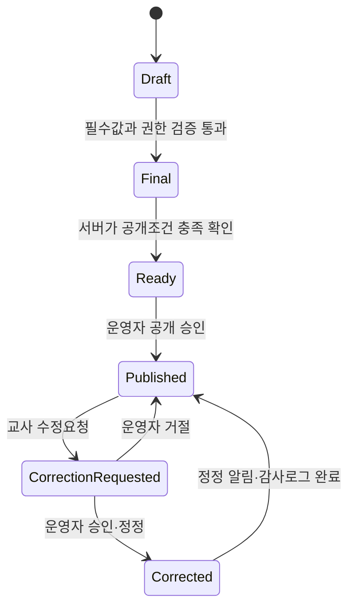

# 화면 목록과 상태 전환표

## 1. 화면 목록

| 화면 | 주소 예시 | 사용자 | 핵심 작업 |
|---|---|---|---|
| 공용 시작 화면 | / | 전체 | 역할별 임시 진입 안내 |
| 운영자 대시보드 | /admin | 학원 운영자 | 미입력·상담·관리 필요 학생 요약 |
| 학생 관리 | /admin/students | 학원 운영자 | 학생·보호자·상태이력 관리 |
| 반·학기·시간표 관리 | /admin/academic | 학원 운영자 | 반배정·과목·수업 회차 관리 |
| 수업 회차 관리 | /admin/sessions | 학원 운영자 | 휴강·보강·대체수업·대표교사 처리 |
| 운영자 조회 | /admin/reports | 학원 운영자 | 조건조회·출결·신입퇴원·상담 현황 |
| 공개 승인 | /admin/publications | 학원 운영자 | 공개대기 자료 승인·정정 |
| 수정요청·감사로그 | /admin/changes | 학원 운영자 | 승인·거절·변경이력 확인 |
| 교사 수업기록 | /teacher/records | 교사 | 반·회차·과목 선택 후 그리드 입력 |
| 교사 비공개기록 | /teacher/private-records | 교사 | 담당 학생 상담·인수인계 작성 |
| 학부모 인증 | /invite | 보호자 | 초대링크·인증키·동의·기기 등록 |
| 학부모 홈 | /parent | 보호자 | 자녀 선택·승인된 일별 기록 |
| 학부모 주간·월간 | /parent/summary | 보호자 | 공개된 평균·출결·나머지 현황 |
| 학부모 문의 | /parent/inquiries | 보호자 | 문의 등록·답변 확인 |

## 2. 교사 수업기록 입력 흐름

1. 교사가 반과 수업 회차를 선택한다.
2. 서버는 로그인 교사의 예정 과목만 보여준다.
3. 대표교사는 출결을 입력하고 최종저장한다.
4. 과목 담당교사는 출석이 최종저장된 학생에게만 과목기록을 최종저장한다.
5. 과목기록은 학생별·과목별로 독립 저장한다.
6. 서버가 공개대기 조건을 다시 계산한다.

## 3. 기록 상태 전환

| 상태 | 의미 | 직접 변경 가능 주체 |
|---|---|---|
| Draft | 임시저장 또는 작성 중 | 담당교사·운영자 |
| Final | 최종저장 완료 | 서버 검증 후 담당교사·운영자 작업 |
| Ready | 공개조건 충족 | 서버 자동 계산 |
| Published | 보호자 공개 완료 | 운영자 승인 |
| CorrectionRequested | 교사의 수정요청 대기 | 교사 등록 |
| Corrected | 운영자 정정 완료 | 운영자 승인 |

## 4. 출결과 과목기록 규칙

| 출결 상태 | 과목기록 | 숙제·전달사항 | 공개대기 기준 |
|---|---|---|---|
| 출석 | 테스트·5점 평가·나머지·특이사항 입력 가능 | 반 공통 숙제 필요 | 예정 과목기록 모두 최종저장 |
| 결석 | 과목기록 입력 불가 | 반 공통 숙제 + 결석 전달사항 필요 | 과목기록은 기다리지 않음 |
| 무단결석 | 과목기록 입력 불가 | 반 공통 숙제 + 결석 전달사항 필요 | 과목기록은 기다리지 않음 |

## 5. 공개 묶음 계산 규칙

- 공개 묶음 단위: `학생 + 수업회차`
- 출석 학생: 출결 + 반 공통 숙제 + 예정된 모든 과목기록이 최종저장되면 Ready
- 결석·무단결석 학생: 출결 + 반 공통 숙제 + 결석 전달사항이 최종저장되면 Ready
- 운영자가 반 단위로 승인 버튼을 눌러도 실제 처리 대상은 Ready 상태 학생만이다.
- 예정 담당교사가 변경되면 서버가 새 예정 담당교사를 기준으로 Ready 상태를 다시 계산한다.

## 6. 운영자 조회 화면 필터

| 조회 화면 | 필수 필터 | 결과 예시 |
|---|---|---|
| 학습현황 | 기간, 학기, 반, 학생, 교사, 과목 | 학생별 일별 기록 |
| 조건조회 | 5점 평가, 출결, 테스트, 나머지 | 이해도·과제 모두 2점 이하 |
| 미입력 현황 | 수업일자, 반, 교사, 과목 | 최종저장되지 않은 과목기록 |
| 상담 현황 | 월, 반, 담당교사, 상담상태 | 완료·미완료·연락불가 |
| 신입·퇴원 현황 | 기간, 반, 담당교사, 상태 | 등록·휴원·복귀·퇴원 목록 |
| 관리 필요 학생 | 기간, 항목, 반 | 판정사유·횟수 |

## 7. 사용자에게 보여줄 대표 오류 메시지

| 상황 | 메시지 |
|---|---|
| 권한 없음 | 이 작업을 수행할 권한이 없습니다. |
| 다른 교사 기록 | 다른 교사가 작성한 과목기록은 수정할 수 없습니다. |
| 출결 미확정 | 출결을 먼저 최종저장한 뒤 과목기록을 최종저장하세요. |
| 결석 입력 차단 | 결석 또는 무단결석 학생은 과목 평가를 입력할 수 없습니다. |
| 필수값 누락 | 입력되지 않은 필수 정보가 있습니다. |
| 10일 잠금 | 최초 최종저장 후 10일이 지나 수정요청이 필요합니다. |
| 버전 충돌 | 다른 기기에서 자료가 변경되었습니다. 최신 자료를 다시 불러오세요. |
| 공개 미충족 | 예정된 기록이 모두 최종저장된 뒤 공개할 수 있습니다. |
