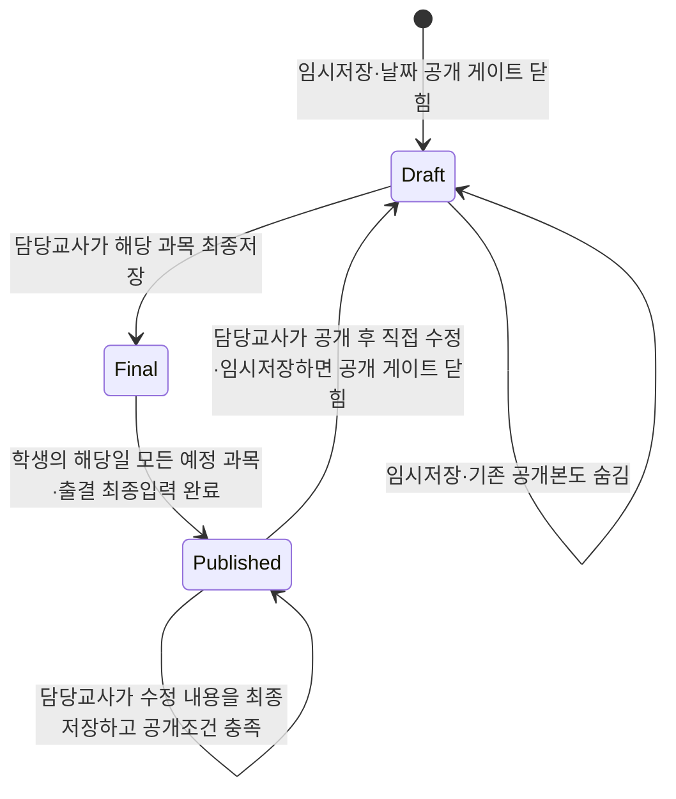

# 화면 목록과 상태 전환표

## 1. 화면 목록

| 화면 | 주소 예시 | 사용자 | 핵심 작업 |
|---|---|---|---|
| 공용 시작 화면 | / | 전체 | 역할별 임시 진입 안내 |
| 운영자 대시보드 | /admin | 학원 운영자 | 미입력·상담·관리 필요 학생 요약 |
| 학생 관리 | /admin/students | 학원 운영자 | 학생·보호자·상태이력·하나의 활성 반 배정, 학기 자동 적용 |
| 반·학기·기초 시간표 관리 | /admin/academic | 학원 운영자 | 학기·반·과목과 반별 문법/독해 담당교사·과목별 강의실·공통 수업시간 설정 |
| 반 운영 설정 | /admin/class-operations | 학원 운영자 | 학생 배정 없이 반 운영 블록 확인·관리(학생 배정은 `/admin/students`) |
| 운영자 조회 | /admin/reports | 학원 운영자 | 조건조회·출결·신입퇴원·상담 현황 |
| 공지사항 관리 | /admin/announcements | 학원 운영자 | 공지 임시저장·게시·보관 |
| 학부모 문의 관리 | /admin/inquiries | 학원 운영자 | 문의 답변·종료·재접수 |
| 교사 수업기록 | /teacher/records | 교사 | 운영 블록·수업일·과목 선택 후 그리드 입력 |
| 교사 공지사항 | /teacher/announcements | 교사 | 게시 공지·인앱 알림 조회 |
| 교사 비공개기록 | /teacher/private-records | 교사 | 담당 학생 상담·인수인계 작성 |
| 학부모 인증 | /invite | 보호자 | 접속 링크·8자리 인증번호·기기 등록(비밀번호 없음) |
| 학부모 홈 | /parent | 보호자 | 자녀 선택·저장된 일별 기록 |
| 학부모 주간·월간 | /parent/summary | 보호자 | 공개된 평균·출결·나머지 현황 |
| 학부모 문의 | /parent/inquiries | 보호자 | 문의 등록·답변 확인 |
| 학부모 공지사항 | /parent/announcements | 보호자 | 게시 공지·인앱 알림 조회 |

## 2. 교사 수업기록 입력 흐름

1. 운영자가 `/admin/academic`에서 공통 수업시간과 문법·독해 자원을 설정한다.
2. 운영자가 `/admin/academic?section=classes`에서 반별 문법·독해 담당교사와 과목별 강의실을 설정하고, `/admin/students`에서 학생을 하나의 반에 배정한다. 학기는 화면에서 선택하지 않는다.
3. 서버는 현재 날짜의 학기를 자동 선택하고, 반별 문법·독해 담당교사를 우선 매칭해 두 과목의 운영 블록과 학생 배정을 생성한다.
4. 교사는 운영 블록·수업 날짜를 선택하고 자기 과목 학생의 출결과 과목기록을 입력한다.
5. 담당교사는 학생 명단 하단에서 A/B 운영구분별 반 공통 숙제를 날짜별로 저장한다.
6. 다음 학기가 시작되면 서버가 기존 반 배정을 종료일로 보존하고 현재 학기 배정·운영 블록을 자동 생성한다. 학생이 이동하면 운영자가 학생 반배정을 변경하고 서버가 운영 블록 학생 배정 기간을 갱신한다.

## 2-1. 보호자 접속 링크 운영 흐름

1. 운영자가 `/admin/students`의 학생·보호자 연결 영역에서 접속 링크와 인증번호를 발급하고 안내문을 복사해 보호자에게 전달한다.
2. 링크와 인증번호는 발급일로부터 60일 동안 최대 5회 사용할 수 있다. 새 링크를 발급하면 같은 학생·보호자의 기존 사용 가능 링크를 자동 취소한다.
3. 보호자가 `/invite`에서 링크 토큰과 인증번호를 확인하면 현재 기기를 등록하고 `/parent`로 이동한다. 보호자당 활성 기기는 1대만 유지한다.
4. 운영자는 `/admin/students`에서 만료 시각·마지막 발급·사용 여부를 확인하고 링크를 재발급하거나 미사용 링크를 취소할 수 있다.
5. 학생을 퇴원 처리하면 연결된 보호자 접근을 차단한다. 재원 중인 다른 자녀가 없는 보호자는 전체 접근도 차단되며, 필요한 경우 운영자가 새 접속 링크를 발급한다.

## 2-2. 공지·문의·알림 운영 흐름

1. 운영자는 `/admin/announcements`에서 공지를 임시저장한 뒤 필요한 시점에 게시한다. 게시된 공지는 대상 역할의 `/teacher/announcements` 또는 `/parent/announcements`에 표시된다.
2. 게시 시 서버가 대상 수신자에게 인앱 알림을 생성한다. 운영자·교사·보호자는 `/api/notifications`에서 자기 수신 알림만 조회하고 읽음 처리할 수 있다.
3. 보호자 문의는 `/parent/inquiries`에서 등록하고, 운영자는 `/admin/inquiries`에서 답변·종료·재접수를 처리한다. 담당 교사 답변은 기존 `/teacher/inquiries` 흐름을 유지한다.

## 3. 기록 저장 규칙

신규 날짜 기반 기록은 임시저장과 과목별 최종저장을 구분합니다. 보호자는 `학생 + record_date` 공개 게이트가 `published`일 때만 해당 날짜의 일별 자료를 조회합니다. 담당 교사는 공개 후에도 수정요청 없이 직접 저장할 수 있습니다. 공개된 날짜를 임시저장하면 기존 공개본은 즉시 숨겨지고, 모든 예정 과목 블록의 과목기록과 출결을 다시 최종저장하면 공개 게이트가 다시 열립니다. `version`은 동시 저장 추적용입니다. 기존 회차의 변경요청 표와 과거 이력은 호환용으로 보존합니다.

## 4. 출결과 과목기록 규칙

| 출결 상태 | 과목기록 | 숙제·전달사항 | 보호자 표시 |
|---|---|---|---|
| 과목별 출석 | 해당 과목의 테스트·5점 평가·나머지·특이사항 입력 가능 | 해당 운영구분의 반 공통 숙제 입력 가능 | 저장된 출결·과목기록·운영구분별 숙제 표시 |
| 과목별 결석 | 과목 평가 입력 불가 | 결석 전달사항 입력 가능 | 저장된 출결·사유 표시 |
| 무단결석 | 과목 평가 입력 불가 | 결석 전달사항 입력 가능 | 저장된 출결·사유 표시 |

## 5. 보호자 조회 규칙

- 신규 조회 단위: `학생 + record_date`
- 보호자는 연결된 자녀에 대한 날짜별 저장 기록만 조회한다.
- 문법·독해처럼 과목이 나뉜 운영 블록은 같은 날짜에 과목별 출결·기록을 각각 표시한다.
- 기존 `publication_bundle=published` 자료는 과거 이력으로 함께 조회할 수 있다.

## 6. 운영자 조회 화면 필터

| 조회 화면 | 필수 필터 | 결과 예시 |
|---|---|---|
| 학습현황 | 기간, 학기, 반, 학생, 교사, 과목 | 학생별 일별 기록 |
| 조건조회 | 5점 평가, 출결, 테스트, 나머지 | 이해도·과제 모두 2점 이하 |
| 미입력 현황 | 수업일자, 반, 교사, 과목 | 저장되지 않은 과목기록 |
| 상담 현황 | 월, 반, 담당교사, 상담상태 | 완료·미완료·연락불가 |
| 신입·퇴원 현황 | 기간, 반, 담당교사, 상태 | 등록·휴원·복귀·퇴원 목록 |
| 관리 필요 학생 | 기간, 항목, 반 | 판정사유·횟수 |

## 7. 사용자에게 보여줄 대표 오류 메시지

| 상황 | 메시지 |
|---|---|
| 권한 없음 | 이 작업을 수행할 권한이 없습니다. |
| 다른 교사 기록 | 다른 교사가 작성한 과목기록은 수정할 수 없습니다. |
| 결석 입력 차단 | 결석 또는 무단결석 학생은 과목 평가를 입력할 수 없습니다. |
| 필수값 누락 | 입력되지 않은 필수 정보가 있습니다. |
| 공통 운영 설정 누락 | 관리자 설정에서 공통 수업시간과 문법·독해 자원을 먼저 등록해 주세요. |
| 버전 충돌 | 다른 기기에서 자료가 변경되었습니다. 최신 자료를 다시 불러오세요. |
| 요일·기간 불일치 | 선택한 날짜가 운영 블록의 요일 또는 기간과 다릅니다. |
